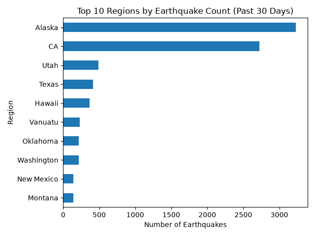

# usgs-earthquake-analysis
Python script that analyzes real USGS earthquake data

## What It Does

Reads a month of real worldwide earthquake data from the USGS and reports:
- Total number of earthquakes
- Largest magnitude and where it happened
- Average magnitude

## How to Run
1. Download the "Past 30 Days - All Earthquakes" CSV from the USGS website (earthquake.usgs.gov/earthquakes/feed/v1.0/csv.php). It is saved as `all_month.csv`.
2. Put `all_month.csv` in the same folder as `Lesson_13_largest_quake.py`.
3. Run `python Lesson_13_largest_quake.py`

## Draw the Histogram
Run `python Lesson_14_histogram.py` to draw the magnitude histogram shown above. It needs matplotlib: `py -m pip install matplotlib`

## Sample Output
- Total earthquakes: 9528
- Largest magnitude: 6.8
- Location of largest earthquake: 105 km NE of Lospalos, Timor Leste
- Average magnitude: 1.81

## What I Practiced
Reading CSV files with `csv.DictReader`, `try/except`, lists, tracking a maximum value

## Author
ChaoyingW, learning Python

## Top 10 Regions

Count earthquakes by region and draw a bar chart. Run Lesson_16_regions.py (needs pandas and matplotlib).

## Files

- `Lesson_13_largest_quake.py`: finds the largest earthquake using csv.DictReader
- `Lesson_14_histogram.py`: draws the magnitude histogram with matplotlib
- `Lesson_15_pandas.py`: the same analysis with pandas, plus the top 5 largest earthquakes
- `Lesson_16_regions.py`: counts earthquakes by region, cleans "CA" to "California", and draws the top 10 chart

